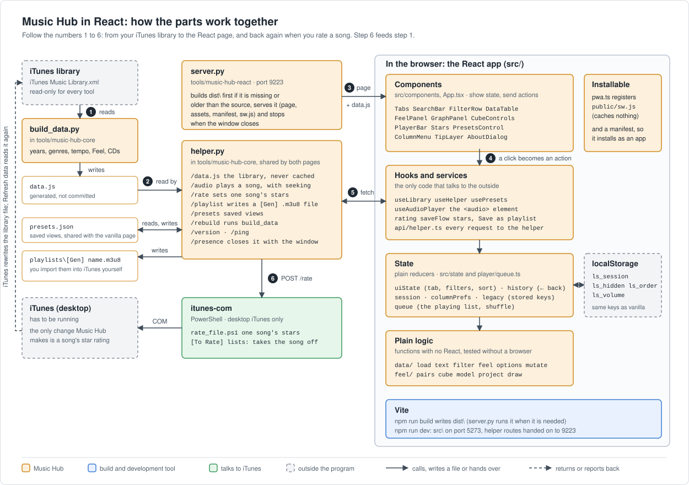
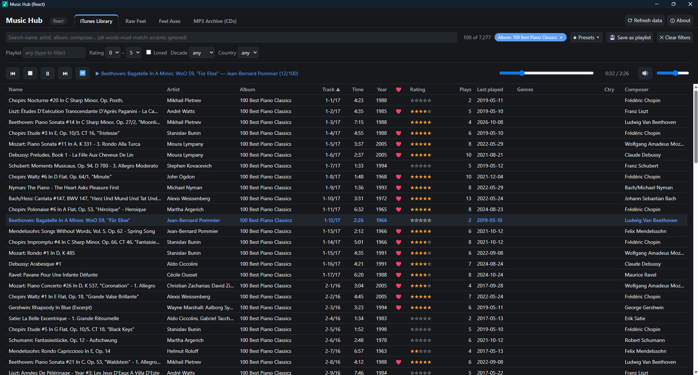
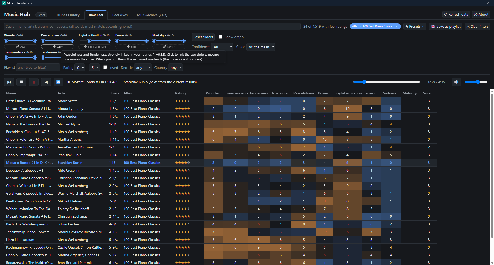
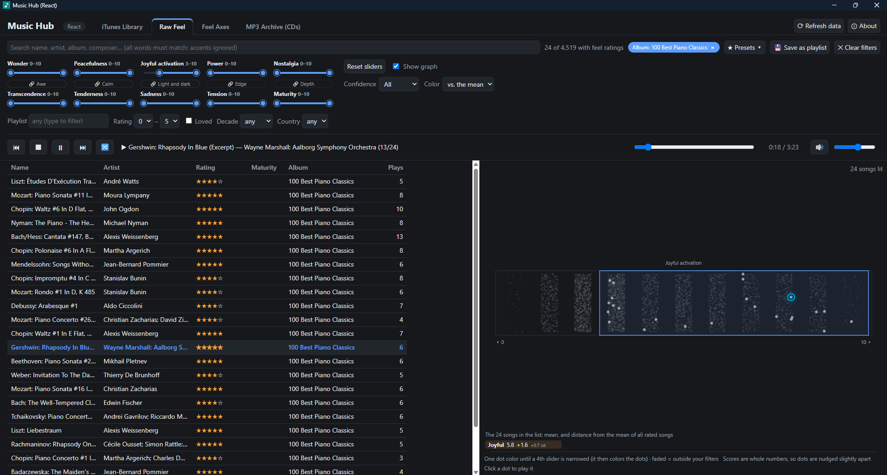
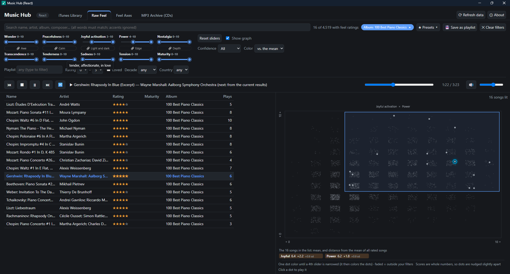
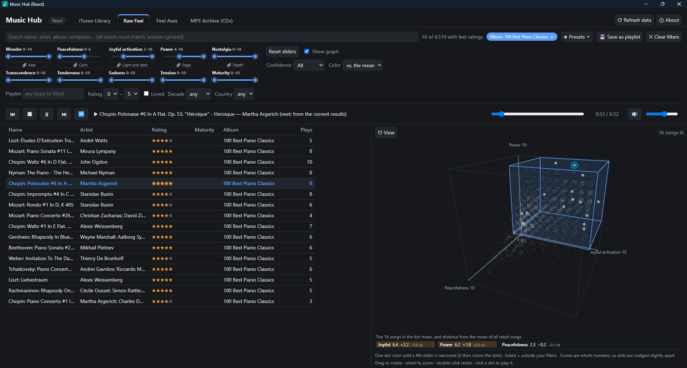
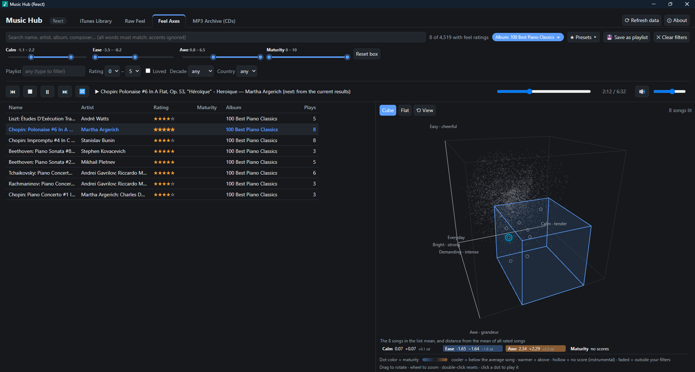

# Music Hub in React and TypeScript

A rebuild of Music Hub (`..\music-hub`, vanilla JavaScript) in React and TypeScript, done slice by slice. All six slices are done: it does what the current page does, has its
own helper and installs as an app. The current page stays in the repo beside it for now. The Python helper (`..\music-hub-core\helper.py`, shared by both pages) and `data.js`
are not changed: this app reads the same data and calls the same endpoints.



**Published as it grew.** Each slice is a tagged commit (`react-slice-1`, `react-slice-2`, ... `react-slice-6`), so the history shows how it was built.

## Status

| Slice | What | State |
|---|---|---|
| 1 | Data layer: types, loading `data.js`, search text, Feel scales, filters, sorting, formatters, with tests | done |
| 2 | The table, search box, filters and sorting on screen (windowed rows), iTunes and archive tabs | done |
| 3 | The Feel tabs: Raw Feel (paired sliders with links, the graph) and Feel Axes (the 3D cube, the flat plots) | done |
| 4 | The player, star rating, Save as playlist, Refresh data (through the helper) | done |
| 5 | Presets, remembered view and song, filter history (with the mouse buttons), column menu, tooltips, About | done |
| 6 | Its own helper (`serve.bat`, port 9223) that builds and serves the page, the installable app (PWA), docs | done |

## Run it

```
npm install            # once
serve.bat              # the app: builds the page if dist\ is missing or older than the source, starts the helper on http://127.0.0.1:9223 and opens it in an app window
./serve.sh             # the same from Git Bash (options: --port 9000, --browser edge, --tab, --no-browser, --keep-alive, --no-build)
preview.bat            # for development: the helper (no page, no build) and the dev server, and opens http://127.0.0.1:5273/
preview.bat vanilla    # the current page instead (the same as ..\music-hub\serve.bat)
npm test               # the tests (invented library only)
npm run typecheck      # TypeScript, strict
npm run build          # type check, then a production build in dist\
npm run dev            # the app at http://127.0.0.1:5273 (the dev server alone, no helper), reading ..\music-hub-core\data.js (read-only); the helper is needed only to play, rate and save
```

`npm run dev` serves the `data.js` of the `music-hub-core` folder at `/data.js`. To try another library (for example an invented one), set
`$env:MUSICLAB_DATA_JS = "C:\path\to\data.js"` first.

**The helper.** Playing songs, rating them in iTunes, writing a playlist file and rebuilding the data go through the Python helper (`..\music-hub-core\helper.py`, the one the current page uses). This folder has its own
`server.py` (started by `serve.bat` or `serve.sh`): it serves the built page from `dist\` on **port 9223** (the current page has 9123, so both can run at once) and closes itself when the window closes. It runs `npm run build`
first when `dist\` is missing or older than `src\`, `public\`, `index.html` or the package files; `--no-build` skips that. The helper has no page of its own to show in `preview.bat`; there the dev server serves it.
`npm run dev` hands those routes (`/audio`, `/rate`, `/playlist`, `/rebuild`, `/presence`, `/ping`, `/presets`, `/version`) on to the helper at `http://127.0.0.1:9223`; set `MUSICLAB_HELPER` to use another (the current page's, `http://127.0.0.1:9123`, works too). The helper only accepts
requests that name itself as their origin, so the dev server rewrites that header. **Without the helper** everything else works: the header says "⚠ helper not running", and playing or rating says
that it needs the helper (instead of every song failing to load and being skipped). The page asks again when you click and when you come back to the window, so starting `serve.bat` is enough, with no reload.

What it does so far (the same as the current page, unless noted):
- **Slice 2:** search and filters on the iTunes and archive tabs, sorting (first click direction per column), a click on an artist, album or CD cell picks a chip
  (Ctrl-click keeps the other filters), a click on a path copies it, **Clear filters**, and a windowed table (only the rows on screen are in the page, so 20,000 rows are fine).
- **Slice 3, Raw Feel:** ten min/max sliders in five stacked pairs, each pair with a link toggle (the second slider follows the first, a mirror image for joyful and
  sadness), a Confidence menu, a Color menu, and score cells tinted against the mean. **Show graph** plots the first four narrowed scales (a line, a quadrant, a cube,
  then a fourth color) beside the list, with the statistics of the songs in it.
- **Slice 3, Feel Axes:** every rated song as a dot in a cube of three independent feelings (Calm, Ease, Awe), colored by maturity; the sliders size a box that picks the songs
  in the list. Drag to turn the cube, the wheel zooms, a double-click resets the view, **Flat** shows the three 2D plots, and hovering a dot names the song.
- **Slice 4, the player:** click a row (or a dot in a graph) to play the list from there; previous, stop, play/pause, next, shuffle, a seek bar and a volume (remembered; the wheel over
  either skips 5 s or changes the volume by 5%); the space bar plays and pauses; the media keys work. Changing a filter never interrupts the song: the next one comes from the new list.
  A protected iTunes purchase can't play in a browser, so it is skipped with a note. A song that fails to load is skipped, and playback stops after five failures in a row.
  The song keeps playing on the MP3 archive tab and the player stays; clicking the song's name there goes to the iTunes Library (on any other tab it stays where it is).
  The playing song is highlighted, ringed in the graphs, and a click on the "now playing" text scrolls the list to it.
- **Slice 4, rating:** click a star to set that rating in iTunes itself (click the current rating to clear it). Rating from a `[To Rate]` playlist also takes the song off it:
  the row turns green and slides out. **Save as playlist** writes the list, in order, as `[Gen] <name>.m3u8` for you to import. **Refresh data** rebuilds from the iTunes library file and reloads.
- **Slice 5, presets:** **★ Presets** saves the current view (tab, filters, sliders, the 3D box and the sort) under a name; apply, replace, rename or delete it later. They live in the helper's
  `presets.json` (the same file the current page uses), or in this browser when the helper is not running. A name that exists is updated.
- **Slice 5, history:** a click on an artist, album or CD, or applying a preset, can be undone with **← back**, the mouse Back button or Alt+Left, and redone with the mouse Forward button or Alt+Right
  (twenty steps; the page keeps itself on the middle of three history entries so the buttons never leave it).
- **Slice 5, the page opens as you left it:** the tab, search, filters, sort and Feel sliders, shuffle, and the song that was playing, back **paused** at its position ("resume at 1:23"; a page must not
  start playing by itself). Saved in this browser in the format of the current page (`ls_session`), so both pages read each other's.
- **Slice 5, columns:** right-click a header for the column menu (show or hide columns, **Reset order**; the last column stays), drag a header onto another to reorder, drag the right edge of a header to resize that column only (double-click the edge for its usual width). Each tab keeps its own
  columns and widths, in `ls_hidden`, `ls_order` and `ls_widths` like the current page.
- **Slice 5, tips and About:** hover text is the page's own (it shows after a moment, follows the pointer, and a song's name also lists the playlists it is in, and a Track cell says "Disc 2 - Track 5 of 12"). **ⓘ About** shows the version and the links.
- **Slice 6, the app:** `serve.bat` serves the built page from its own helper (port 9223) and opens it in an app window; the browser can **install** it as an app ("Music Hub (React)", a teal icon, so it is not mistaken for the current page's blue one).
  Like the current page, the service worker caches nothing (`data.js` must be fresh, the music is streamed). It is registered only by the built page, not by the dev server. An app installed from `:9223` needs the helper on that port.
  When the installed app window opens on a desktop narrower than 1090 px or shorter than 600 px (the width that keeps the Raw Feel options beside the sliders), it grows to that once, as the current page's does (`src/appWindow.ts`); a normal browser tab, a phone and a smaller screen are left alone. You can still drag the window smaller (a web page cannot stop that), but the page then keeps at least 1090 px of width and scrolls sideways instead of squeezing, with the wide Raw Feel layout (`html.app` in `index.css`).
  `make_icons.py` redraws the icons in `public\`. `py -3 -m unittest test_server` tests when it builds and what port and name it uses.

To check the data layer against your real library (read-only; it asserts no numbers, it compares each filter with a second, naive count from the raw rows):

```
$env:MUSICLAB_DATA_JS = "C:\path\to\music-lab\tools\music-hub-core\data.js"; npm test
```

## Screenshots

The album "100 Best Piano Classics" (the Feel scores are estimates). The window title and the **React** badge show which version this is.

The iTunes Library tab, filtered to one album with an album chip:



Raw Feel as a list, and its graph with one, two and three sliders narrowed:









Feel Axes, with the box that picks the songs in the list:



## Where the old code went

| Current page (`index.html`) | Here |
|---|---|
| `fold`, `sp`, `jn`, `index`, the search terms | `src/data/text.ts` |
| `objs`, `build`, `FEELSTAT` | `src/data/load.ts` (`buildDataset`, `parseLibraryScript`) |
| `FEEL`, `feelOk`, the ten scales | `src/data/feel.ts` |
| `run()` (filters, playlist order, chips) and the sort | `src/data/filter.ts` (`filterSongs`, `filterArchive`, `sortRows`) |
| `fmt` | `src/data/format.ts` |
| the shape of `window.LIB` | `src/data/types.ts` |
| the decade, country and category menus | `src/data/options.ts` |
| `COLS`, `W`, `HIDE_BY_DEFAULT` and the cell text | `src/columns.ts` |
| the controls' values, `pickFacet`, `resetFilters`, the sort rule | `src/state/uiState.ts` (one reducer) |
| `render()` and the paging ("Show more") | `src/components/DataTable.tsx` (windowed rows) |
| the search row, chips and filter row | `src/components/SearchBar.tsx`, `FilterRow.tsx`, `Tabs.tsx` |
| the `data.js` script tag | `src/hooks/useLibrary.ts` |
| `flash()` | `src/hooks/useFlash.ts` |
| `Q`, `order`, `pos`, `startQueue`, `playAt`, `next`, `prev`, shuffle, `stale` | `src/player/queue.ts` (a reducer) and `src/player/useAudioPlayer.ts` (the audio element) |
| `applyVolume`, `wheelSteps`, `mmss` | `src/player/volume.ts`, `src/player/useVolume.ts` |
| the player bar | `src/components/PlayerBar.tsx` |
| `rateSong`, the `[To Rate]` removal | `src/rating.ts`, `src/data/mutate.ts`, `src/components/Stars.tsx` and `App.tsx` |
| Save as playlist, Refresh data, the helper's routes | `src/playlist/saveFlow.ts`, `src/api/helper.ts`, `src/hooks/useHelper.ts` |
| `captureState`, `applyState`, the presets menu and the `presets.json` calls | `src/state/legacy.ts` (the stored format), `src/presets/`, `src/components/PresetsControl.tsx` |
| `hist`, `fwd`, `goBack`, `goForward`, the popstate trick | `src/state/history.ts` (a reducer) and `src/hooks/useHistoryButtons.ts` |
| `saveSession`, `restoreSession` | `src/state/session.ts`, with the song's return in `src/player/queue.ts` (`restore`) |
| `hidden`, `colOrder`, the column menu and the header drag | `src/state/columnPrefs.ts`, `src/components/ColumnMenu.tsx`, `src/components/DataTable.tsx` |
| `#tip`, `playlistsOf` | `src/tips/` (`TipLayer`, `tips.ts`) |
| the About dialog | `src/components/AboutDialog.tsx` |
| `PAIRS`, `syncPair`, the link toggles, `feelOrder`, `readFeel` | `src/feel/pairs.ts`, `src/feel/feelState.ts` (state rules) and `src/components/FeelPanel.tsx` |
| the `.dual` slider | `src/components/DualRange.tsx` |
| `buildCube`, `cubeOk`, `readCube` | `src/feel/cube.ts` and `src/components/CubeControls.tsx` |
| `cubeModel`, `feelModel`, `devColor`, `jit`, the statistics numbers | `src/feel/model.ts` |
| the camera and the 3D projection | `src/feel/project.ts` |
| `draw3D`, `plot2D`, `drawFlat`, `pickAt` (canvas drawing) | `src/feel/draw.ts` |
| the graph panel, its statistics block and legend, drag/wheel/hover | `src/components/GraphPanel.tsx` |
| `devStyle`, `feelTip` (the tinted score cells and their hover text) | `src/columns.ts` (`scoreBackground`, `feelTip`) |

## Rules for this folder

- The data layer (`src/data`) and the state (`src/state`) are plain functions with no React in them, so they can be tested without a browser. Components are
  thin: they show state and send actions. Component tests use Testing Library with jsdom (a file opts in with `// @vitest-environment jsdom`).
- Behavior matches the current page, quirks included, until the page is retired (for example a typed word matches anywhere inside the text, and rows
  with no score sort before rows with one). Change behavior in a separate commit, never while porting.
- Tests use the invented library in `src/data/fixture.ts`, never the real one.
