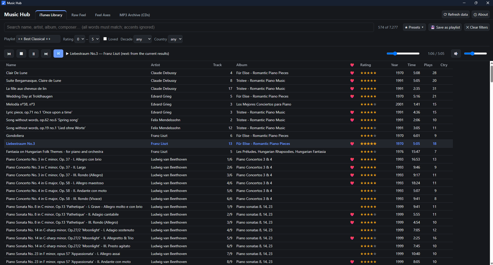
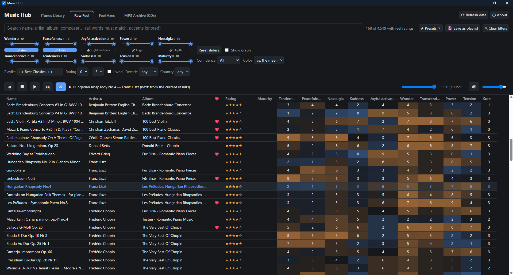
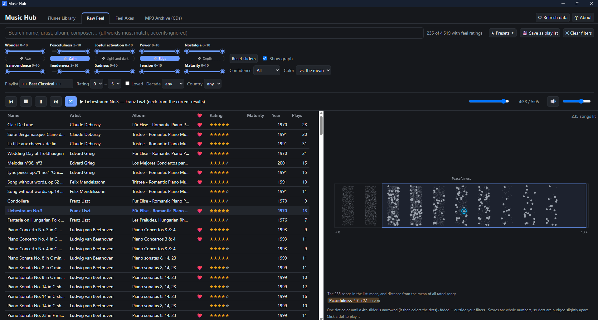
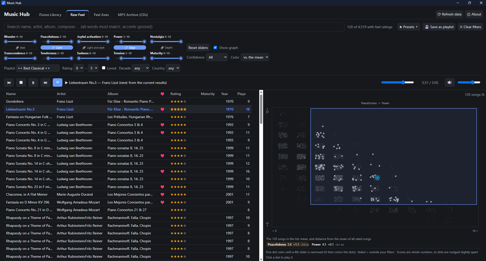
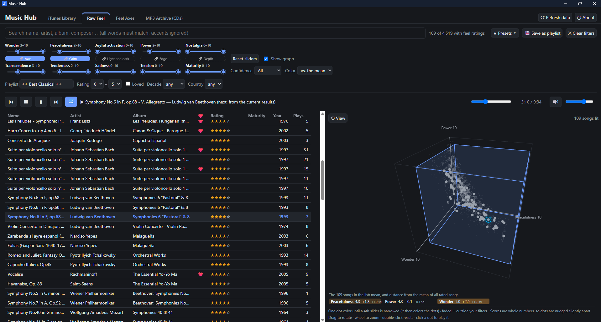
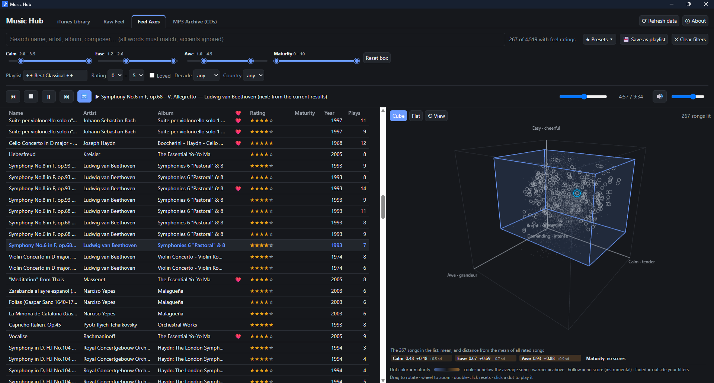

# Music Hub

Music Hub is a single web page, served by a small local helper, for searching, playing, rating and exploring your music
library. It reads the iTunes library, the old CD archive (optional: MP3 files burned on CDs) and a set of
derived data (original release years, artist genres, and "feel" ratings), and puts them in one fast, filterable list.

It runs only on this computer. It **reads** the iTunes library XML and the media files and **never changes them**. The only things it
can change in iTunes are what you ask for with a click: a song's star rating, and removing a song from a `[To Rate]` playlist after you rate it.

1. [Quick start](#quick-start)
2. [The four tabs](#the-four-tabs)
3. [Searching, filtering and sorting](#searching-filtering-and-sorting)
4. [Playing music](#playing-music)
5. [Rating songs](#rating-songs)
6. [Raw Feel and Feel Axes](#raw-feel-and-feel-axes)
7. [Where the data comes from](#where-the-data-comes-from)
8. [Remembering where you were](#remembering-where-you-were)
9. [Install as an app](#install-as-an-app)
10. [Troubleshooting](#troubleshooting)
11. [Files in this folder](#files-in-this-folder)

---

## Quick start

Double-click **`serve.bat`** (or run `./serve.sh` from a Git Bash terminal). It starts the helper on `http://127.0.0.1:9123` (this computer
only) and opens Music Hub in an app-style window (Chrome, else Edge).

- **Closing the app window stops the helper.** Each open page keeps one connection (`/presence`) to the helper; when the last one drops
  (window closed, browser crashed) the helper exits after a few seconds, so a simple reload doesn't kill it. Ctrl+C in the terminal also stops it.
- **Already running?** Running `serve.bat` again just opens the window again.
- **Port busy?** It takes the next free port. Choose one with `serve.bat --port 9000` (or set `LIBRARY_SEARCH_PORT`).
- **Options:** `--keep-alive` (don't stop when the window closes), `--browser edge`, `--tab` (a normal browser tab instead of an app window), `--no-browser`.
- **After any code change, restart the helper** (close the window, run `serve.bat`), then click **Refresh data**.

Without the helper you can still double-click `index.html`: search, filters and sorting work, but playing music, rating songs and rebuilding the data do not.

## The four tabs

| Tab | What it is |
|---|---|
| **iTunes Library** | Every song file in iTunes, with stars, hearts, plays, original year, genres and country. You can play and rate from here. |
| **Raw Feel** | The rated songs, searchable by emotional tone: ten sliders (nine GEMS scales plus maturity). See [Raw Feel and Feel Axes](#raw-feel-and-feel-axes). |
| **Feel Axes** | The same songs as dots in a cube of three independent feelings; a box you size picks the songs in the list. |
| **MP3 Archive (CDs)** | The index of MP3s burned on CDs. The paths are not on disk, so these songs can't be played; the tab shows which ones are already in iTunes. |

**Screenshots** (a classical playlist; the Feel scores are estimates).

The iTunes Library tab, with the player bar above the list:

Raw Feel as a list: the ten scores are columns, tinted against the mean of all rated songs:

Raw Feel with its graph. Narrow one slider and the graph is a line, two make a plane, three a cube (a fourth colors the dots):

Feel Axes: every rated song in a cube of three independent feelings, and a box that picks the songs in the list:

The top row has the title, the tab strip and, at the right, **⟳ Refresh data** with its status message. Right under it are the search box (an **×** at its right end clears the text when
there is some), the result count, **★ Presets** and **✕ Clear filters**.

**Back and Forward.** The mouse's Back and Forward buttons (or Alt+Left and Alt+Right) undo and redo the filter views, exactly like the
**← back** chip: clicking an artist or album, or applying a preset, can be stepped back and then forward again (up to 20 steps; a new click
clears the Forward steps). They never leave the page. Typing in the search box and moving the sliders are not steps.

## Searching, filtering and sorting

**Search.** Type words in the box: all words must match (in name, artist, album or composer; the MP3 Archive searches name, artist and album), accents are ignored, and punctuation counts as a word break
("spider man" finds "Spider-Man"), but also joined ("aha" finds "a-ha", "acdc" finds "AC/DC").

**Filters** (iTunes and Feel tabs): **Playlist**, **Rating from-to** (0 = unrated, so "from 1" leaves unrated songs out), **Loved**, **Decade**, **Country**.
On the archive tab: **Category** and **In iTunes** (any / in iTunes / not in iTunes, each with a count).

- **Playlist** is a combo box: type part of a name and the list narrows; pick one (or type its full name) to filter. It lists every iTunes
  playlist, smart ones included, with the song count. With no sort chosen, results follow the playlist's own order.
- **Click an Artist or Album cell** (or **Volume**, the CD id, on the archive tab) to show only that artist/album/CD. A plain click *replaces* the other filters;
  **Ctrl-click** (⌘-click) *adds* it to them. A chip such as `Artist: Coldplay ×` appears next to the count (click × to remove it) with a **← back**
  button that restores the filters you had before the click (up to 20 steps). The match ignores capitals and accents, so it also finds "A-HA" and "a-ha".
- **✕ Clear filters** resets the search, every filter, the chips and (in the Feel tabs) the sliders. Sort order and columns are kept.

**Presets (★ Presets, next to ✕ Clear filters).** Saves the current *view* under a name: the tab, search text, every filter, artist/album/volume chips, the Feel sliders and color mode, the 3D box and the sort order
(not the playing song or your column layout). Type a name and press Save (an existing name is updated); click a preset to apply it; ⟳ replaces it with the current view, ✎ renames, ✕ deletes. **Applying a preset replaces your current view and can be
undone with ← back.** Presets are stored by the helper in `presets.json` in `tools/music-hub-core/` (shared with the React version), so they survive a port change, a cleared browser or switching between Chrome and Edge (without the helper they fall back to this browser's storage).

**Sorting.** Click a column header to sort, click again to reverse. For **Rating, Plays, Loved and the ten Feel scores** the first click puts the highest
first; for every other column the first click goes A to Z / low to high.

**Columns.** Right-click any header for the column menu (show/hide, **Reset order**); drag a header onto another to move it, and drag the right edge of a header to resize that column only (double-click the edge for its usual width). The iTunes, Raw Feel, Feel Axes and archive
tabs each keep their own columns and widths. The Path column is hidden by default; click it to copy a song's file path.

**Track column (iTunes tab).** Shows the track number and how many tracks the album has, as iTunes has them tagged: `5/13`, or `2-5/12` (disc 2, track 5 of 12 on that disc) on a
multi-disc album. Blank when the tags are empty. Hover a cell for the plain words: "Disc 2 - Track 5 of 12" (no disc on a single-disc album). To look for missing tracks, sort by **Album**: each album stays together in disc and track order (a compilation with a different artist on every song stays one album; two different albums that share a title, like several "Greatest Hits", are told apart by artist), so a gap in the numbers (3, 5) or a
count above the number of songs you have means a track is missing. Sorting by the **Track** column itself goes disc by disc: every track of disc 1 by number, then disc 2 (a song with no disc tag counts as disc 1). It needs **⟳ Refresh data** once after updating, so the page learns the track numbers. It is hidden by default on the Raw Feel and Feel Axes tabs.

## Playing music

Click a song to play the current results; ⏮ ⏹ ⏯ ⏭ and 🔀 (shuffle) work on the results as filtered and sorted when playback started. **Space** plays/pauses, and the media keys work too. Playback goes on when you switch tabs, including the MP3 archive tab (those songs are on CDs, so nothing can be started there). Click the song's name in the player to jump to its row; from the archive tab that takes you to the iTunes Library.

- **Volume:** 🔊 mutes; the slider sets the volume (remembered; squared so low levels are finer). Mouse wheel over the volume area changes it by 5%; over the progress area it skips 5 seconds.
- **Jump to the song:** click the now-playing text at the top, or use ⏮ / ⏭, and the list scrolls to the playing song and flashes it.
- **Changing filters or sort** drops the queue but never stops the song playing; the next song then comes from the current results.
- **Protected songs:** old iTunes Store purchases (`.m4p`, FairPlay) can't play in a browser. They show a 🔒 before the name; clicking one says why, and the queue skips them.
- **Stop** unloads the song and drops the queue.
- The helper streams the audio (with seeking) and serves **only files listed in `data.js`**, so nothing else on the disk is reachable.

## Rating songs

Click a star in the **Rating** column (iTunes and Feel tabs) to set that rating **in iTunes itself**; click the star that matches the current rating again to clear it. This
needs the desktop iTunes to be installed (it is controlled through its COM interface, see `tools/itunes-com/`) and the helper to be running. If anything goes wrong, a message at the
top right says why and nothing changes.

- **Hearts ("Loved") can't be set** from here: iTunes does not expose them to scripts. Set them in iTunes or on the iPhone.
- **`[To Rate]` playlists:** if a playlist whose name contains `[To Rate]` is selected in the Playlist box, rating a song also removes it from that
  playlist (the row turns green, then slides out). Only the playlist entry goes: the song stays in the library. Only plain playlists are touched, never smart ones.
- **Playlists of a song:** hover a song's name in the iTunes tab to see the playlists it is in (up to 15, then "and N more"): the ones made by hand
  or by an agent, never the rule-driven (smart) ones. It needs the playlist data in `data.js`, so click **⟳ Refresh data** once after updating.
- **💾 Save as playlist** (next to Presets, iTunes tab, needs the helper): writes the songs now in the list, in the order shown, as
  `[Gen] <name>.m3u8` in the repo's `playlists\` folder (UTF-8, CRLF). Filter first (Raw Feel, Feel Axes box, stars, anything), then save. Music Hub
  never touches iTunes for this: import the file yourself (*File → Library → Import Playlist…*), then check it. It refuses a name that is already in
  `playlists\bak` (already imported) and asks before replacing a file still waiting to be imported. If iTunes already has a playlist of that name, you are
  warned: importing the same name only adds the songs iTunes doesn't have, it never replaces the old list (delete the old playlist in iTunes first).
- **ⓘ About** (top right) opens a small box: the version (the helper reads the `VERSION` file at the repo root each time; without the helper, the one `data.js` was built with; "Not released yet" until the first release), when the data was built, what Music Hub is, who made it, the license, and the links to the source and the Ko-fi page. Esc, **Close** or a click outside closes it.
- After a change, iTunes rewrites its library file within seconds to a minute; click **⟳ Refresh data** to see ratings made elsewhere.

## Raw Feel and Feel Axes

"Feel" is an estimate of how each song feels, on the nine **GEMS** scales from the Geneva Emotional Music Scale (Zentner, Grandjean and Scherer, 2008): wonder, transcendence, tenderness,
nostalgia, peacefulness, power, joyful activation, tension, sadness, plus a tenth, **maturity** (how emotionally mature the lyrics are: ambivalence, responsibility, commitment as a
choice, repair, acceptance, honest loss; empty for instrumentals). Each is 0 to 10, with a confidence (1 low, 2 medium, 3 high).

> **These are Claude's estimates, from knowing the songs, not measurements.** They come from one rater in one pass, so some overlap between scales is
> partly the rating process. Details and numbers: `tools/emotions/README.md`, `stats.md`, `correlations.md`.

**Raw Feel tab.** Ten min/max sliders (two knobs each) narrow the list; a song is listed only if every scale is inside its range. **Confidence** (All, Low, Medium, High) lists only the songs rated at that confidence, so Low is the list to take with a grain of salt. **Reset sliders**, Show graph, Confidence and the color choice sit right after the sliders (beside them on a wide window, on one line below them on a narrow one).

**Paired sliders and links.** The ten sliders are stacked in five pairs of scales that move together in the ratings: Awe (wonder, transcendence), Calm (peacefulness, tenderness),
Light and dark (joyful, sadness, opposites), Edge (power, tension) and Depth (nostalgia, maturity). The correlations behind the first three are strong (r of 0.8 or more);
the last two are weak (about 0.4) and drawn with a dashed pill, grouped by meaning only (`tools/emotions/correlations.md` has the numbers; the ones in the page are a note and may drift). The pill between the two sliders
(🔗 Calm) is a **link toggle**, off at first. With a link on, moving either slider moves its partner: same range for the first four pairs, the mirror image for Light and dark
(joyful 0 to 4 shows sadness 6 to 10). Turning a link on makes the narrowed slider lead (the upper one if both are narrowed). Two linked sliders count as one for the graph (only the one narrowed first becomes an axis; the other still filters).
The link states are kept with the session and in presets (a preset saved before links existed leaves them as they are).
The score columns are colored by distance from the average song: **cool = below the mean, warm = above, full color at ±2.5 standard deviations** (the **Color** menu switches to a plain
darker-is-higher heat map). Hover a score to see the scale's mean and standard deviation over all rated songs and how far this song is from them, in points and in standard deviations.

**Feel graph (Raw Feel tab, "Show graph").** Plots the songs in a panel beside the list and hides the score columns (the column set is the same as on the Feel Axes tab). Nothing is capped: you can narrow any number of sliders. The graph uses
the **first four scales you narrowed**, in that order: one scale draws a **line**, two a **quadrant**, three a **cube** (drag to rotate, wheel to zoom), and a fourth **colors the dots** (cool = below the mean, warm = above). If you widen a
slider back to 0 to 10, the next narrowed scale takes its place. Scales narrowed beyond four still filter the list; the statistics block names them ("also filtering, not plotted"). The blue box is the range you set (it wraps the first and last
whole score). Scores are whole numbers, so dots are nudged slightly apart. The switch and the narrowing order are saved with the session and in presets.

**How the selection differs from the library (under every graph).** A block above the legend shows, for each scale in the graph (all ten in the Feel graph while no slider is narrowed), the **mean of the songs in the list**, the **distance from the mean of all rated
songs** in points, and the same distance in standard deviations, shaded cool or warm. Hover a cell for the exact numbers. On Feel Axes it covers the three axes (their means are 0 and spread 1 over all rated songs) and maturity. Pick an artist or album
(click its name in the list) and the block shows how that artist's songs differ from the average song.

**Feel Axes tab.** Every rated song is a dot in a cube. The three axes are **independent** (principal components of the nine GEMS scales; `tools/emotions/axes.py` prints the share of the variation each holds),
each named after its high end and growing toward the pleasant side:

| Axis | High end | Low end |
|---|---|---|
| **Calm** | Calm · tender | Bright · strong |
| **Ease** | Easy · cheerful | Demanding · intense |
| **Awe** | Awe · grandeur | Everyday |

Dot color is **maturity** (cool/warm as above; a hollow ring means no score). Three axis sliders plus a maturity slider size a translucent box; dots inside stay bright, the rest fade,
and the list on the left shows exactly the songs inside the box (other filters still apply). Drag to rotate, wheel to zoom, double-click to reset the view; hover a dot to see the song, click it to play it. A bright blue ring (with a soft glow) marks the song that is playing, in the cube and in the flat plots (even when your filters fade it).
The **Flat** switch shows the same selection as three 2D plots. The axes are computed once by `tools/emotions/axes.py` and saved in `axes.json`, so the cube doesn't shift as ratings are added.
Drawn with a plain canvas: no library, works offline.

## Where the data comes from

`tools/music-hub-core/build_data.py` builds one file, **`data.js`** (`window.LIB = {...}`, git-ignored and always regenerable; it lives in `tools/music-hub-core/`, shared with the other Music Hub page). The page loads it with a `<script>` tag and filters it in memory; a plain script
file works even from `file://`, where `fetch` of a JSON file would be blocked, and a database would be overkill for a list this size.

| Input | Read from | Used for |
|---|---|---|
| iTunes library | the file named by `source_music_library` in `config.json` (read-only) | Songs, playlists, stars, loved, plays, last played |
| Original release years | `tools/release-years/release_years.csv` | The Year column (instead of iTunes' reissue years) |
| Artist genres and country | `tools/artist-genres/artist_genres.csv` | Genres, Country, Decade |
| Feel ratings | `tools/emotions/gems.json` | Raw Feel and Feel Axes tabs |
| Composite axes (Calm, Ease, Awe) | `tools/emotions/axes.json` | Feel Axes tab |
| Tempo (BPM) | `tools/bpm/bpm.csv` | Built into the data but the column is hidden (see below) |
| CD archive | the spreadsheet named by `cd_archive_index` in `config.json` (optional, read-only; without it the archive tab is empty). Its Path column shows `$DL` in place of the drive letter, which only said which CD drive the disc was read in | The archive tab |
| Spelling repairs | `tools/music-hub-core/mojibake_fixes.json` | Fixes accented letters lost in the CD index |

Rebuilding: **⟳ Refresh data** (with the helper running) rebuilds `data.js` from iTunes and swaps the new data in without reloading the page: your search, scroll position and the playing song are kept.
Or run `./build_data.sh` (or `py -3 build_data.py`) yourself; both pass on to the script in `tools/music-hub-core/`. Re-run the index tools first when you add songs: `tools/release-years/update_index.py`, `tools/artist-genres/update_genres.py`.

**Row order in `data.js`:** the iTunes columns end with `...protected, feel, path`; `path` must stay last (the helper reads it to decide which files it may stream).

**The CD archive and garbled text.** The CD spreadsheet lost some accented letters when it was made; they show up as `�` (for example `Cl�sicos`). `tools/music-hub-core/mojibake_fixes.json` maps each damaged
word to its real spelling (a `?` stands for one lost character); `build_data.py` applies it before matching archive songs to iTunes, so repaired names match their iTunes copies. A damaged word with no
entry gets a plain replacement mark. The spreadsheet itself is never modified.

**BPM is hidden.** The BPM column and filter were removed because AcousticBrainz tempos aren't reliable enough (slow songs often show double their tempo; only part of the library has one).
The data is still built; bringing the column back means adding `["bpm","BPM",1]` to the iTunes columns in `index.html`.

## Remembering where you were

Closing and reopening Music Hub restores the **tab** (including Raw Feel and Feel Axes), the **search text**, every **filter**, any **artist/album chip**, the **sort order**, the **Shuffle** state, the **color mode**
and the **song that was playing, at its position**. The song comes back *paused* (a page must not start playing by itself); press ▶ to continue. It is all kept in this browser's `localStorage`
(`ls_session`, plus `ls_order`, `ls_hidden`, `ls_widths` and `ls_volume` for columns, their widths and volume). A song, playlist or sort column that no longer exists is ignored, and so is a damaged save.
**Stop** forgets the song but keeps the filters; **Clear filters** resets the filters.

## Install as an app

With the helper running, open the page in Chrome or Edge and use **Install** (the icon at the right end of the address bar). It then opens in its own window with its own icon. The app is only the page:
the helper (`serve.bat`) must be running, and the port must stay the same (an app installed from `:9123` won't work from another port).
`manifest.webmanifest`, `sw.js` (installability only; it caches nothing, so data is always fresh) and the icons (`make_icons.py`) are served by the helper (`server.py` starts it).

**Window size.** A web app manifest cannot set one, so when the app window opens on a desktop, the page makes it at least `MIN_W` × `MIN_H` (1090 × 600, at the end of `index.html`), once. 1090 is the narrowest
width that keeps the Raw Feel controls beside the sliders. You can still drag the window smaller (the browser decides how small, and a web page cannot stop it), but the page then keeps at least 1090 px of width and scrolls sideways instead of squeezing: the Raw Feel controls stay beside the sliders. A normal browser tab and a phone are left alone, and keep the narrow layouts.

## Troubleshooting

| Symptom | Likely cause and fix |
|---|---|
| A new feature doesn't show | The page is the old one. Close the app window, run `serve.bat` again, click **Refresh data**. |
| I rated or added songs in iTunes and Music Hub doesn't show it | iTunes can take up to a minute to rewrite its library file. Wait, then click **Refresh data**. |
| Clicking a star says it can't reach iTunes | The helper must be running (not just `index.html`) and the desktop iTunes installed; a message at the top right gives the reason. |
| A song won't play | It may be a protected 🔒 purchase, or the file moved. Archive (CD) songs can't be played. |
| The Feel tabs are empty | `tools/emotions/gems.json` is missing or `data.js` is old: click **Refresh data**. |
| "Port in use" | Another program has the port; the helper takes the next free one, or use `--port`. |

## Files in this folder

| File | What it is |
|---|---|
| `index.html` | The whole page: markup, styles and script. |
| `build_data.py` / `build_data.sh` | Pass on to the scripts in `tools/music-hub-core/` (so the old command still works). |
| `server.py` | Starts the helper for this page (port 9123). The helper itself is `tools/music-hub-core/helper.py`. |
| `serve.bat` / `serve.sh` | Start the helper and open the page. |
| `manifest.webmanifest`, `sw.js`, `icon-192.png`, `icon-512.png`, `make_icons.py` | The installable-app pieces. |

**Shared with the React version** (`tools/music-hub-react/`), in `tools/music-hub-core/`: the helper (audio, rating, playlists, presets, rebuild), `build_data.py`, the built `data.js`
and your `presets.json`. The two pages can run at the same time (this one on port 9123, the React version on 9223).

**To try the React version:** run `serve.bat` (or `./serve.sh`) in `tools/music-hub-react/`. It builds the page when it is out of date (the first time you need `npm install` there), starts its own helper on port 9223 and opens it in an app window. Its README has the details.

Related tools: `tools/itunes-com/` (rating through iTunes), `tools/emotions/` (Feel ratings and axes), `tools/release-years/`, `tools/artist-genres/`, `tools/bpm/`, and `AGENTS.md` at the repo root for the conventions behind all of it.
